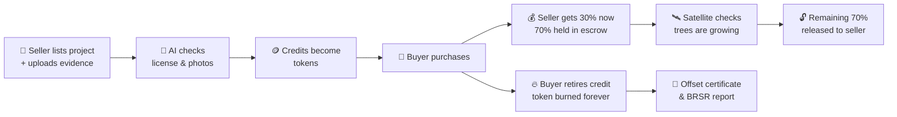
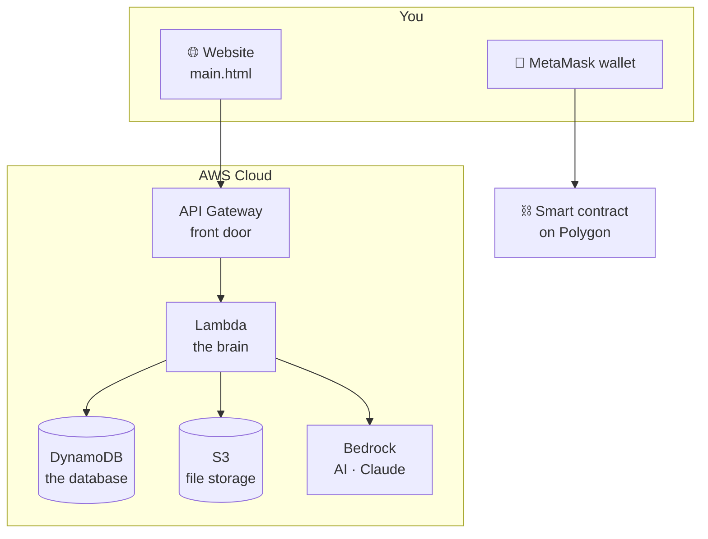

# CarbonChain: A Beginner's Guide

_No prior knowledge of carbon markets, blockchain, or AWS needed._

---

## 1. The big idea in one minute

When a factory, an airline, or a person releases carbon dioxide (CO₂), it warms the planet. One way to balance that out is to **pay someone else to remove or avoid the same amount of CO₂**: plant a forest, run a solar farm, or capture methane from a landfill.

That payment is called a **carbon credit**. **1 carbon credit = 1 tonne of CO₂** removed or avoided.

**CarbonChain is an online marketplace for buying and selling carbon credits**, built so that nobody can cheat.

- **Sellers** are climate projects (forests, solar farms, mangroves…). They list their credits.
- **Buyers** are companies or individuals who want to offset their pollution. They buy credits and then "use them up" (retire them).

---

## 2. Why do we need a new marketplace?

Today's carbon markets have three well-known problems. CarbonChain is built around fixing them.

### Problem A: Double counting 🔁
The same tonne of CO₂ gets sold to two different buyers, and both claim it.

**Our fix:** every credit becomes a unique digital **token** on a **blockchain** (explained below). A token can only be in one wallet at a time. Once a buyer uses it, the token is **burned** (destroyed forever), so it can never be sold again.

### Problem B: Greenwashing 🌿❌
A project claims to have planted a forest, but the forest doesn't exist or never grew.

**Our fix:** every project shows its **evidence**: satellite photos, sensor readings, auditor reports, and GPS location. AI checks uploaded photos and documents for fakes. Satellites measure whether trees are actually growing before the seller gets most of their money.

### Problem C: Middlemen 💸
Brokers, registries, and validators can take 30–40% of the money, and payment takes months.

**Our fix:** a **smart contract** (a program on the blockchain) pays the seller directly, with only a small 2.5% platform fee.

---

## 3. Key ideas explained simply

| Term | Plain-English meaning |
|---|---|
| **Carbon credit** | A certificate saying "1 tonne of CO₂ was removed or avoided". |
| **Blockchain** | A shared digital record book that thousands of computers keep copies of. Once something is written, nobody can secretly change it. |
| **Token** | A digital item recorded on the blockchain. Here, each token = 1 carbon credit. |
| **ERC-1155** | A standard "shape" for tokens on Ethereum-style blockchains, so wallets and apps know how to handle them. |
| **Polygon** | A fast, cheap blockchain compatible with Ethereum. CarbonChain is designed to run on it. |
| **Wallet / MetaMask** | An app that holds your tokens and crypto money. Your wallet address (like `0x742d…F2e1`) is your account number. |
| **ETH** | The digital currency used to pay for credits. |
| **Smart contract** | A program on the blockchain that runs automatically: "when the buyer pays, send the seller their share". Nobody can stop or tamper with it. |
| **Retire / Burn** | Using a credit to cancel out your emissions. The token is destroyed so it can't be reused. |
| **Escrow** | Money held safely by the smart contract until a condition is met (like a deposit you get back once the job is done). |
| **NDVI** | A satellite measurement of how green and healthy plants are, from 0 (bare ground) to 1 (dense forest). If NDVI goes up over time, trees are really growing. |
| **Sentinel-2** | European Space Agency satellites that photograph the whole Earth every few days. |
| **Greenwashing** | Pretending to be more eco-friendly than you are. |
| **AQI** | Air Quality Index. Higher means more polluted air. |
| **BRSR** | Business Responsibility & Sustainability Report, a sustainability report Indian listed companies must publish. |
| **Monoculture** | Planting only one kind of tree. It's bad for nature, so CarbonChain rewards projects with 8+ native species. |

---

## 4. How a credit's life works

---

## 5. A tour of every screen

Open `main.html` in a web browser (Chrome or Edge work best) with an internet connection.

### Demo accounts
| Role | Email | Password | 2FA code |
|---|---|---|---|
| Buyer | `buyer@demo.com` | `Demo@1234` | `123456` |
| Seller | `seller@demo.com` | `Demo@1234` | `123456` |

### 🏠 Home (Marketplace)
The landing page. It explains the three problems (A, B, C) and shows headline numbers (credits listed, ETH traded, CO₂ offset), a live price chart, and a grid of projects. You can **search**, **filter by type** (reforestation, solar, wind, methane, ocean, energy efficiency), and **sort** by price or impact. A **live ticker** scrolls credit prices across the top.

### 📋 Projects
All verified projects in one grid, with tabs by project type.

### 🛰️ Evidence (on every project card)
Click the satellite icon on any project to see its proof: an **anti-greenwash score**, satellite photo dates, number of IoT sensors, the auditor's name, the certification standard (e.g. Verra, Gold Standard), an IPFS link, and GPS coordinates.

### 🌍 Eco Map
An interactive world map of all projects.
- Pins group together when zoomed out; zoom in to see **parcel boundaries** (land plots).
- Switch between a street map and a **satellite view**.
- Jump to regions (Asia, Americas, Europe…) or filter by project type.
- Click a parcel to see **live weather** (temperature, wind) and its vegetation health (NDVI).

### 🛒 Buying credits
Click **Buy** on a project, choose how many credits, and the screen shows exactly where the money goes (97.5% to the seller, 2.5% platform fee). After purchase the credits are **automatically retired (burned)**, so they can't be double-counted.

### 🔗 Token Ledger
A public list of every credit token: its ID, which project it came from, who owns it, and whether it's **active** or **retired**. You can type a token ID to **verify** who owns it, or retire credits you hold.

### 👤 My Portfolio (buyers only)
Your holdings, purchase history, your tokens, a downloadable **carbon offset certificate** (PDF), a watchlist of projects you like, and a one-click **BRSR Scope 3 report** (a multi-page PDF companies can use for sustainability reporting).

### 🏭 Seller Hub (sellers only)
Earnings, pending payouts, credits sold, and a side-by-side diagram comparing the old broker system (seller gets ~60%, waits 30–90 days) with CarbonChain. It also shows your projects, a sales table, your top buyers, and an activity feed.
**🛰️ Unlock Escrow** asks the satellite system whether your trees have grown more than 15%. If they have, the held-back 70% is released to you.

### 🌱 List New Project (sellers only)
A guided form to publish a project:
1. Company details and the certifying body (Verra, Gold Standard, government ministries…).
2. Upload a **government license**. AI reads it and checks for signs of forgery.
3. Upload a **satellite or drone image**. The app reads the GPS location hidden inside the photo and AI checks it isn't fake or AI-generated.
4. Confirm the location on a map.
5. A checklist shows what's still missing before you can submit.

### 🚁 Bounty Board
Anyone can earn a reward (0.005 ETH) by flying a drone over a planting site and uploading a geotagged photo. AI checks that real young trees are visible and that the GPS matches. Think of it as **crowd-sourced fact-checking** of tree planting.

### 🛡️ Security
Explains how AI protects the platform: detecting fake satellite images, forged documents, suspicious trading (like someone buying from themselves to fake volume), and double-spending. A log shows recent security events.

### 🧮 CO₂ Calculator
Enter your yearly flights, driving, electricity use, and diet to get your personal carbon footprint in tonnes, how many credits you'd need, and the cost. It also shows equivalents like "trees planted" and "car km avoided".

### 💬 Verde, the AI assistant
The chat bubble in the corner. Ask anything ("How do I buy credits?", "What does burning mean?"). Without an AI key it gives built-in answers; with a key (button **🤖 AI Active** in the top bar) it uses a real AI model.

### 🌐 Languages
Switch between English, Hindi, Spanish, German, Portuguese, and French from the top bar.

---

## 6. Smart features hidden in the smart contract

These rules live in `CarbonChainToken.sol` and run automatically on the blockchain:

| Feature | What it means |
|---|---|
| **Milestone escrow** | Seller gets 30% at sale; 70% waits until satellites confirm growth. |
| **Anti-monoculture rule** | Projects with fewer than 8 native tree species get their reward multiplier cut in half. |
| **Soil-moisture safety** | If sensors report soil moisture below 20%, sales for that plot pause until the land recovers. |
| **Emergency irrigation** | During a heatwave (>40 °C with no rain for 5 days), 5% of the escrow is automatically sent to a local water tanker to save the saplings. |
| **Adopt-a-Tree caretakers** | 5% of every sale goes into a pool for a local community member who looks after the trees. |
| **Auditor bounty** | Drone verifiers are paid 0.005 ETH per verified site. |
| **Retire = burn** | Retired credits are destroyed permanently. |

---

## 7. How the pieces fit together (technical, but simple)

| Piece | File | Job |
|---|---|---|
| **Website** | `main.html` | Everything you see and click. |
| **Lambda** (AWS) | `lambda_function.py` | Server code that runs only when called, with no server to manage. Handles users, projects, orders, AI, weather, and satellite checks. |
| **DynamoDB** (AWS) | `database.py` | Stores users, projects, and transactions. |
| **S3** (AWS) | `s3_service.py` | Stores uploaded files: licenses, drone photos, reports. |
| **Bedrock** (AWS) | inside `lambda_function.py` | Gives access to Claude, the AI model behind "Verde". |
| **Smart contract** | `CarbonChainToken.sol` | The money and token rules on the blockchain. |
| **Open-Meteo** | (external) | Free live air-quality and weather data. |

---

## 8. What's real and what's demo (important!)

CarbonChain is a **hackathon prototype**. The website is a working demo, but much of it is simulated so it can run without any setup.

| Real ✅ | Simulated for the demo 🎭 |
|---|---|
| Map, map tiles, and live weather | Projects, users, and purchases (stored only in your browser) |
| GPS reading from photos, location lookup | Blockchain transactions (the transaction IDs are random) |
| CO₂ calculator math | Login 2FA (the code is always `123456`) |
| PDF certificates and BRSR reports | Satellite NDVI results |
| AI chat and AI scans, if you add an AI key | Security dashboard numbers and events |
| Language switching | Bounty payouts and seller earnings |

When you open the site, an amber **DEMO DATA** badge in the top bar tells you the numbers come from a built-in sample dataset (`mock-data.js`): a believable sales history for the seller, a portfolio for the buyer, and so on. Everything you do (buying, retiring, unlocking escrow) is remembered in your browser; use **Reset demo data** at the bottom of the page to start over.

The **AWS backend and the smart contract are written but not yet connected** to the website. Connecting them is the next step (see `PROJECT_STATE.md`).

---

## 9. Where AWS can take this next

Some AWS services that would make the demo parts real:

- **Amazon Cognito:** real sign-up, login, and two-factor authentication.
- **Amazon Bedrock:** Claude looks at the actual uploaded photos and documents to spot fakes.
- **Amazon Textract:** reads text off license certificates automatically.
- **Amazon Rekognition:** spots trees and saplings in drone photos.
- **Sentinel-2 satellite data on AWS:** real tree-growth (NDVI) measurements instead of simulated ones.
- **AWS IoT Core:** real soil-moisture sensors in the forest.
- **Amazon EventBridge:** checks every parcel for drought every day, automatically.
- **AWS KMS:** safely signs blockchain transactions without exposing secret keys.
- **Amazon SES / SNS:** sends real emails and alerts.
- **AWS Amplify:** puts the website online with a proper web address.

The full list, with reasons, is in `PROJECT_STATE.md` §7.

---

## 10. Try it yourself: a 5-minute walkthrough

1. Open `main.html`. Browse the **Home** page and click 🛰️ on a project to see its evidence.
2. Open **🌍 Eco Map**, zoom into India, and click a parcel to see live weather.
3. Click **Sign In**, use `buyer@demo.com` / `Demo@1234`, and enter `123456`.
4. Buy 5 credits from any project and watch them get auto-retired.
5. Go to **🔗 Token Ledger** and find your burned tokens.
6. Go to **My Portfolio** and download your **offset certificate** and **BRSR report**.
7. Sign out, sign in as `seller@demo.com`, open **Seller Hub**, and click **🛰️ Unlock Escrow**.
8. Try **List New Project** and upload any photo to watch the AI checks.
9. Finally, use the **🧮 CO₂ Calculator** to work out your own footprint.
