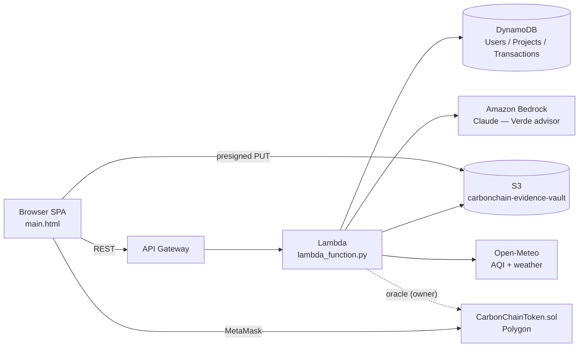
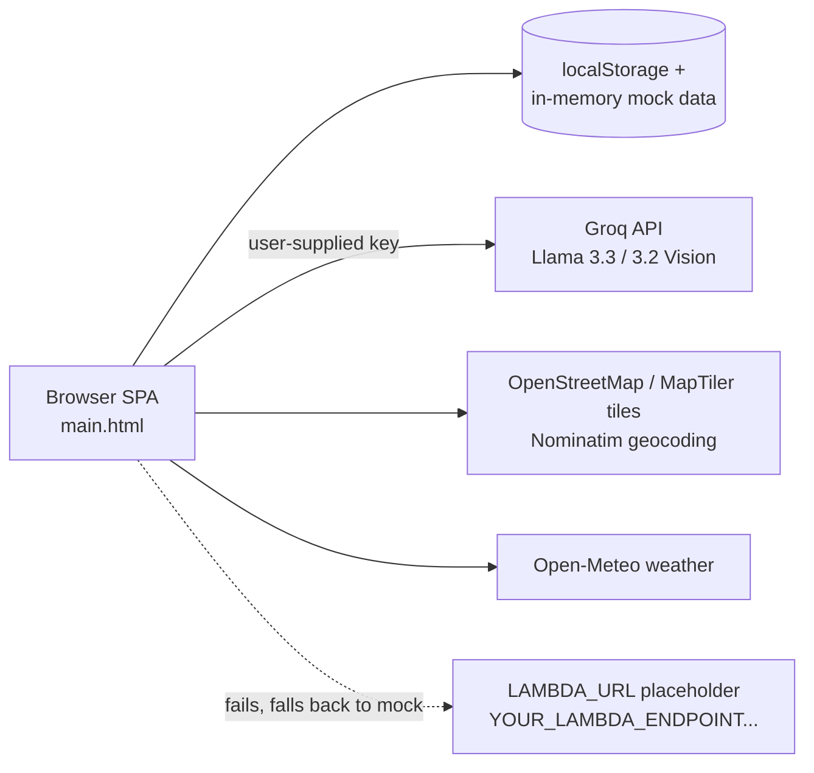

# CarbonChain — Project State Document

_Snapshot date: 2026-10-11 · Branch: `main` @ `8713266` · Repo: github.com/kesshavjhha12-tech/carbonchain_

---

> **Update (post-cleanup, same day):** the structural issues in §6.1 are **fixed**: `main.html` is now a single document (1.6k lines) that loads `styles.css`, `config.js` and `app.js` (conflict resolved, 0 duplicate IDs). The API contract mismatches (§6.2 #5) and the unauthenticated escrow write (§6.3 #7, `/verify-ndvi` is now read-only) are fixed, the drought monitor fails closed, S3 keys are unique, and `infra/` contains a CloudFormation template + `deploy.ps1`. The frontend now reads projects from DynamoDB and writes users, projects and orders back (`api()` in `app.js`), with automatic fallback to demo data. Verde chat tries Bedrock first. **Still open:** on-chain integration, real auth (Cognito), real NDVI/OCR/vision pipelines, fee-copy vs. contract mismatch, MapTiler key rotation. Sections 3-6 below describe the state *before* this cleanup.

> **Update (mock-data pass):** demo mode now ships a complete, consistent dataset in `mock-data.js` (`CC_MOCK`): a 15-sale history across the three projects owned by the demo seller, the demo buyer's portfolio (14 credits held, 10 retired, 24 tokens, 2 watchlist items), escrow states (awaiting NDVI / released / locked), two paid-out bounty sites, recent security events, and marketplace KPIs computed from project supply. Fixtures are deterministic (seeded PRNG); session changes persist in `localStorage` (`cc_demo_state`). The UI shows a **DEMO DATA** pill whenever `API_URL` is empty. Connecting AWS later means replacing the fixtures with API responses of the same shape (`syncProjectsFromApi()` already does this for projects). Remaining in the "simulated" column: NDVI, evidence-scan verdicts, blockchain transaction hashes, 2FA, authentication.

## 1. What CarbonChain is

CarbonChain is a **decentralized carbon-credit marketplace** built for the AWS hackathon. Climate projects (sellers) list verified carbon credits; companies and individuals (buyers) purchase them and retire them to offset emissions. Each credit is a blockchain token, so it can only be owned once and burned once.

It targets three known failures of today's carbon markets:

| Problem | CarbonChain's answer |
|---|---|
| **A. Double counting:** the same tonne of CO₂ gets sold twice | ERC-1155 token per credit; retirement burns the token on-chain (`retireCredit`) |
| **B. Greenwashing:** projects that don't exist or don't grow | Evidence vault (satellite, IoT, auditor, GPS), AI image/document fraud scans, NDVI satellite checks gating escrow |
| **C. Middlemen:** brokers and registries take 30–40% | Smart contract pays the seller directly; 2.5% protocol fee |

On top of this it adds climate-resilience features: **milestone escrow** (30% paid upfront, 70% released when satellite NDVI shows real canopy growth), **anti-monoculture guardrails** (fewer than 8 native species halves the multiplier), **parametric drought irrigation** (escrow auto-funds a water tanker at >40 °C with no rain), **caretaker micro-staking** (5% of sales go to a local "adopt-a-tree" caretaker), and a **crowd-proof drone bounty** (0.005 ETH for verifying planting sites).

---

## 2. Repository inventory

| File | Lines | Role | State |
|---|---|---|---|
| `main.html` | 14,801 | **The running app.** Self-contained SPA: inline CSS + inline JS | Works when opened in a browser, but contains two concatenated HTML documents (see §6.1) |
| `app.js` | 6,850 | Extracted copy of the frontend JS | **Not loaded by `main.html`.** Contains an unresolved git merge conflict (`<<<<<<< HEAD` at line 1, `=======` at 3853, `>>>>>>>` at 6850) |
| `styles.css` | 4,736 | Extracted copy of the CSS | **Not loaded by `main.html`** |
| `lambda_function.py` | 417 | AWS Lambda API router (API Gateway v1/v2 events) | Written, not deployed (frontend points at a placeholder URL) |
| `database.py` | 573 | DynamoDB data layer with in-memory fallback | Written, not deployed |
| `s3_service.py` | 126 | S3 presigned upload URLs + server uploads | Written, not deployed |
| `CarbonChainToken.sol` | 314 | ERC-1155 marketplace contract (Solidity 0.8.20, OpenZeppelin v5) | Written; no deploy script, tests, or frontend ABI wiring |
| `requirements.txt` | 2 | `boto3`, `botocore` | Already provided by the Lambda Python runtime |

There is no README, `.gitignore`, IaC template (SAM/CDK/CloudFormation), test suite, or build tooling.

---

## 3. Architecture

### 3.1 Intended architecture



### 3.2 What actually runs today



**The frontend is a self-contained demo.** All projects, users, purchases, tokens, and security events are mock data in JavaScript and `localStorage`. The backend and smart contract exist as code but are not connected.

---

## 4. Feature inventory (frontend: `main.html`)

| Page / feature | What it does | Real or simulated |
|---|---|---|
| **Live ticker** | Scrolling price ticker across projects | Random price drift every 8 s |
| **Home / Marketplace** | Hero, A/B/C problem cards, KPIs, price index chart, search and type filters, sort, project cards | Mock data (8 projects) |
| **Projects** | Verified project grid with type tabs | Mock |
| **Eco Map** (`page-map`) | Leaflet map with clustered pins, procedurally generated parcel polygons at high zoom, region jump, type filters, OSM/MapTiler satellite tiles, canopy radii, parcel list, live telemetry panel | Map and tiles real; temperature/wind from Open-Meteo real; parcels illustrative (hash-generated); NDVI static |
| **Evidence modal** (🛰️) | Anti-greenwash score, satellite dates, IoT sensor count, auditor, standard, IPFS CID, GPS | Mock `EVIDENCE_VAULT` |
| **Buy modal** | Quantity, fee breakdown (97.5% seller / 2.5% protocol), balance check | Simulated tx hash; balance in localStorage |
| **Auto-retire on purchase** | After buying, tokens are immediately "burned" to prevent double counting | Simulated |
| **Token Ledger** | Per-token ownership ledger, verify a token ID, retire/burn | Mock ledger generated at load |
| **Retire modal + PDF certificate** | Burn credits, generate an offset certificate with jsPDF, "email" notification | PDF real (client-side); email simulated |
| **Register / Login** | Role selection (buyer/seller), password strength meter, MetaMask connect, 6-digit 2FA | Mock users with plaintext passwords; 2FA code is always `123456`; non-MetaMask wallets get a random address |
| **Buyer Portfolio** | Holdings, transaction history, my tokens, offset certificate, watchlist, **BRSR Scope 3 report** (multi-page PDF) | Data from localStorage; PDF real |
| **Seller Hub** | Earnings, pending payout, payout comparison (broker vs contract), my projects, sales table, top buyers, activity feed, **🛰️ Unlock Escrow** (NDVI check) | NDVI tries Lambda, then falls back to a deterministic mock |
| **Submit Project** | Company verification, certifying body, government license upload with pixel analysis and AI doc scan, satellite image upload with EXIF GPS (exifr) and AI image scan, GPS map picker, reverse geocoding, submission checklist | Pixel heuristics real; AI scans real only with a Groq key; submission saved locally |
| **Bounty Board** | 4 drone verification sites; upload a geotagged image; AI verifies; "pays" 0.005 ETH | Tries Lambda `/scan-evidence`, then falls back to pixel heuristics; payout simulated |
| **Security dashboard** | AI fraud KPIs, explanation of image/document/transaction AI checks, security event log | Static mock events |
| **CO₂ Calculator** | Flights, driving, electricity, and diet give tonnes/yr, credits needed, ETH cost, and equivalents | Real formula (client-side) |
| **Verde AI chat** | Floating chat assistant with suggestions | Groq Llama 3.3 when a key is set; otherwise canned keyword replies |
| **AI key modal** | User pastes a Groq key (`gsk_…`), stored in localStorage | Real |
| **i18n** | EN, HI, ES, DE, PT, FR | Real (hard-coded dictionaries) |

**Contract and backend features with no UI yet:** caretaker registration and yield claim, drought monitor / emergency irrigation, soil-moisture pause, monoculture multiplier, Verde-on-Bedrock (`/api/agent`), user sync/roles, portfolio API, project creation API, orders API, S3 presigned uploads.

---

## 5. Backend and contract reference

### 5.1 Lambda API (`lambda_function.py`)
Every route accepts the `/api/...` prefix or the bare path. CORS is `*`. **No authentication on any route.**

| Method | Path | Purpose | Notes |
|---|---|---|---|
| POST | `/api/users/sync` | Upsert user by wallet | → `CarbonChain_Users` |
| POST | `/api/users/role` | Switch buyer/seller | |
| GET | `/api/portfolio?wallet=` | Purchases, retirements, totals | Table scan |
| POST | `/api/upload-url` | S3 presigned PUT URL | Key is `folder/filename`, so same-name uploads overwrite each other |
| GET | `/api/projects?status=` | List projects | Table scan |
| POST | `/api/projects` | Create project | Warns (doesn't reject) when species < 8 |
| POST | `/api/orders` | Record BUY/MINT/RETIRE, decrement supply | Conditional decrement |
| POST | `/api/agent` | Verde advisor: live AQI + urgency multiplier + Bedrock Claude | UHI cooling and wind-shielding values are `random` |
| GET/POST | `/api/drought-monitor` | Open-Meteo past-5-day heat/rain gives a drought flag | **Returns `is_drought: true` when the weather API fails** |
| POST | `/api/verify-ndvi` | NDVI pass/fail; on pass sets escrow to 100% | **NDVI values are `random.uniform`, not satellite data** |
| POST | `/api/scan-evidence` | "AI" evidence scan | Always returns `PASS / 94%`; only the filename goes to Bedrock, never the image |

Bedrock: `bedrock-runtime.invoke_model`, default `anthropic.claude-3-5-sonnet-20241022-v2:0`, falling back to `claude-3-sonnet`. Both are legacy model IDs; switch to a current Claude model on Bedrock via `BEDROCK_MODEL_ID`. If Bedrock is unavailable it returns a canned recommendation.

Environment variables: `AWS_REGION`, `BEDROCK_MODEL_ID`, `PROJECTS_TABLE`, `TRANSACTIONS_TABLE`, `USERS_TABLE`, `S3_BUCKET_NAME`.

### 5.2 DynamoDB (`database.py`)
| Table | PK | Key attributes |
|---|---|---|
| `CarbonChain_Users` | `wallet_address` | role, organization_name, email, credentials_hash, registration_date, last_active |
| `CarbonChain_Projects` | `project_id` | name, lat/lng, area_ha, seller_wallet, total/available credits, price_per_ton_eth, native_species, species_count, ndvi, aqi, escrow_released_percent, status |
| `CarbonChain_Transactions` | `tx_id` | order_id, buyer/seller wallet, project_id, token_id, tonnage, tx_hash, type (MINT/BUY/RETIRE), is_burned |

Every function **silently falls back to an in-memory mock** on any exception. That keeps demos running, but it also hides real failures, and data written in fallback mode is lost on every Lambda cold start.

### 5.3 Smart contract (`CarbonChainToken.sol`)
ERC-1155 + Ownable + ReentrancyGuard.

Purchase money flow (`purchaseWithEscrow`):
```
totalCost
 ├─ 2.5%  protocol fee  → treasury
 ├─ 5.0%  caretaker fee → caretakerPool[tokenId]
 └─ 92.5% seller share
     ├─ 30% → seller immediately
     └─ 70% → escrow (released by owner after NDVI check)
```
Other functions: `mintCarbonCreditAdvanced` (species < 8 sets multiplier to 0.5×), `updateSoilMoisture` (purchases blocked below 20%), `releaseEscrow`, `emergencyIrrigate` (5% of escrow to tanker), `registerCaretaker` / `claimCaretakerYield`, `payoutAuditorBounty` (0.005 ETH), `retireCredit` (burn), `setTreasury`.

---

## 6. Known issues and gaps (prioritised)

### 6.1 Critical: codebase hygiene
1. **`main.html` is two HTML documents concatenated** (doc 1 at lines 1–5053 has the nav but no script; doc 2 at lines 5054–14802 has the pages, the map, and the script). This produces **175 duplicate element IDs**. `getElementById` returns the first match, so some UI is driven from doc 1 and some from doc 2, and the ticker, modals, toast container, and chat widget are all rendered twice. Fix: keep one `<head>`, one nav, and one copy of each page.
2. **`app.js` contains an unresolved merge conflict** and two copies of every top-level `const`. If it were loaded it would throw a `SyntaxError` immediately. Fix: resolve it, then make `main.html` load `app.js` + `styles.css` instead of inlining them.

### 6.2 Critical: frontend and backend are not integrated
3. `LAMBDA_URL = 'https://YOUR_LAMBDA_ENDPOINT…'` is a placeholder; every call fails and falls back to mock data.
4. The frontend calls only 2 of the 11 API routes (`/verify-ndvi`, `/scan-evidence`). Projects, users, orders, portfolio, uploads, the Verde agent, and drought monitoring are never called.
5. **The API contracts don't match:**
   - `/verify-ndvi`: the UI reads `canopy_growth_pct` and `threshold_met`; Lambda returns `growth_percent` and `verdict`. Against a real Lambda, the UI would throw on `.toFixed()`.
   - `/scan-evidence`: the UI sends `image_b64` + `file_name` and reads `response.result`; Lambda reads `filename` and returns a flat object.
6. The smart contract isn't deployed, and the frontend has no ethers.js/viem or ABI, so all tx hashes are random strings.

### 6.3 High: security
7. **Every Lambda route is unauthenticated.** Anyone can call `POST /verify-ndvi` to set any project's escrow to 100%, create projects, or forge orders.
8. Frontend auth is mock: plaintext passwords ship in JS, and the 2FA code is always `123456`.
9. **The MapTiler API key is hard-coded** in `main.html` and committed to a public repo. Rotate it.
10. The Groq key lives in browser localStorage and goes straight from the browser to Groq, so it is exposed to any XSS.
11. S3 upload keys aren't unique and aren't tied to a user, so evidence files can be overwritten.

### 6.4 High: verification is simulated
12. NDVI is random, the evidence scan always passes, and UHI cooling/wind shielding are random. These are the platform's core trust claims, so the demo should label them clearly or they should be implemented (see §7).
13. The drought monitor fails *open*: if the weather API is down it reports a drought, which on-chain would trigger an emergency escrow release.

### 6.5 Medium: consistency
14. **The UI and the contract disagree on economics.** The UI says "97.5% to the seller in under 15 seconds". The contract pays 30% of 92.5% (about 27.75%) upfront and escrows the rest, minus a 5% caretaker fee.
15. **AI branding is inconsistent:** the Security page says "Groq · Llama 3.3/3.2 Vision", the Bounty Board says "Claude 3.5 Sonnet", and the backend uses Bedrock Claude. For an AWS hackathon, move all AI to Bedrock behind Lambda.
16. Contract: only the owner can mint, so `listing.seller` is always the owner and third-party sellers can't list. Escrow, caretaker pools, and bounty funds share one contract balance with no separate accounting. The refund uses `.transfer` (2300-gas limit).
17. DynamoDB uses full-table `scan` for listings and portfolios. Use a GSI on `status` and on `buyer_wallet`. Portfolio lookup is case-sensitive in DynamoDB but lower-cased in the mock.

### 6.6 Low: project tooling
18. No README, `.gitignore`, IaC, tests, CI, Hardhat/Foundry project, or deploy scripts.

---

## 7. Amazon services: current and recommended

### 7.1 Already used in code
| Service | Where | Use |
|---|---|---|
| **AWS Lambda** | `lambda_function.py` | Whole API |
| **Amazon API Gateway** | Event parsing for v1 and v2 | HTTP front door (needs to be created) |
| **Amazon DynamoDB** | `database.py` | Users, Projects, Transactions |
| **Amazon S3** | `s3_service.py` | Evidence vault, presigned uploads, audit reports |
| **Amazon Bedrock** | `invoke_bedrock()` | Verde advisor, evidence analysis |
| **Amazon CloudWatch Logs** | `logging` | Lambda logs |
| **AWS IAM** | Implicit | Lambda execution role |

### 7.2 High-value additions (directly fix gaps above)
| Service | Replaces / fixes | How it plugs in |
|---|---|---|
| **Amazon Cognito** | Mock auth, fake 2FA (#7, #8) | User pool with TOTP MFA; `buyer`/`seller`/`admin` groups; Cognito authorizer on API Gateway; store wallet as a custom attribute |
| **Amazon Bedrock (Claude, multimodal)** | Groq in the browser (#10, #15), fake evidence scan (#12) | Send the actual image/PDF to Claude via the Converse API from Lambda; one AI provider, no browser keys |
| **Amazon Bedrock Guardrails** | Unfiltered chat | Topic and PII filters on Verde |
| **Amazon Bedrock Knowledge Bases** | Canned chat replies | RAG over Verra/Gold Standard methodologies, BRSR guidance, project docs in S3 |
| **Amazon Bedrock Agents / AgentCore** | Hand-rolled `/api/agent` | Verde as an agent with tools: `get_aqi`, `get_ndvi`, `list_projects`, `check_drought` |
| **Amazon Textract** | Fake license OCR | Extract certificate number, company, and dates from uploaded licenses; cross-check form fields |
| **Amazon Rekognition** (+ Custom Labels) | Pixel heuristics | Detect vegetation, trees, and saplings in drone and satellite uploads; Custom Labels for sapling counting |
| **Sentinel-2 on the AWS Open Data Registry** | Random NDVI (#12) | Read Sentinel-2 L2A Cloud-Optimized GeoTIFFs from S3 (STAC search), compute real NDVI for the parcel polygon in Lambda or a container |
| **AWS Step Functions** | Ad-hoc flows | Verification pipeline: upload → Textract → Rekognition → Bedrock → human review → mint → notify |
| **Amazon EventBridge Scheduler** | Manual drought/NDVI checks | Daily drought monitor per parcel; quarterly NDVI escrow milestone checks |
| **AWS KMS (secp256k1 keys)** | No oracle signer (#6) | The contract owner/oracle key lives in KMS; Lambda signs `releaseEscrow`, `updateSoilMoisture`, `emergencyIrrigate` without ever exposing a private key |
| **Amazon Managed Blockchain (AMB) Access / Query** | Missing chain connectivity | Managed Ethereum (and Polygon where supported) RPC endpoints; AMB Query for token balances and transfer history in the ledger page |
| **AWS Secrets Manager / SSM Parameter Store** | Hard-coded MapTiler key (#9) | Store third-party keys and the contract address; Lambda reads them at runtime |
| **AWS Amplify Hosting** or **S3 + CloudFront** | Opening a local HTML file | Host the SPA over HTTPS on a CDN |
| **AWS WAF** + API Gateway usage plans | Open API (#7) | Rate limiting, bot control, IP reputation |
| **AWS SAM or AWS CDK** | No IaC (#18) | One template for API, Lambda, tables, bucket, and roles |

### 7.3 Nice-to-have
| Service | Use |
|---|---|
| **AWS IoT Core** + **Amazon Timestream** | Real soil-moisture/temperature sensors; IoT Rule → Lambda → `updateSoilMoisture` on-chain; time-series charts in the evidence vault |
| **Amazon SES** | Real retirement certificates and purchase emails (replaces `simulateEmailNotification`) |
| **Amazon SNS** | Drought, escrow-release, and fraud alerts to sellers, caretakers, and admins |
| **Amazon Location Service** | Map tiles (including satellite/hybrid), geocoding, geofencing parcels; replaces MapTiler and Nominatim |
| **S3 Object Lock** | WORM-immutable evidence and BRSR reports, a strong anti-greenwash proof |
| **DynamoDB Streams** | React to new orders (mint, notify, analytics) |
| **Amazon Athena + Amazon QuickSight** | ESG analytics: CO₂ retired by buyer, region, project type |
| **Amazon Translate** | Extend the six hard-coded languages; translate project descriptions |
| **Amazon Polly** | Voice responses for Verde |
| **AWS X-Ray** / CloudWatch dashboards & alarms | Tracing and monitoring for the API |
| **Amazon GuardDuty** | Account-level threat detection, which backs up the Security page's claims |

> Avoid **Amazon QLDB** for the ledger. AWS ended support for it in 2025, and the on-chain token already provides the immutable ledger.

---

## 8. Suggested roadmap

**Phase 0: clean up (≈½ day)**
- De-duplicate `main.html`, resolve the `app.js` conflict, load `app.js` + `styles.css` externally.
- Rotate and remove the MapTiler key; add `.gitignore` and a README.

**Phase 1: make the AWS backend real (≈1–2 days)**
- SAM/CDK template: API Gateway + Lambda + 3 DynamoDB tables (with GSIs) + S3 bucket.
- Set `LAMBDA_URL` from config; wire marketplace, buy, portfolio, and submit flows to the API.
- Fix the `/verify-ndvi` and `/scan-evidence` response shapes.
- Cognito auth plus an API Gateway authorizer.

**Phase 2: make verification real (≈2–3 days)**
- Bedrock multimodal evidence scan (send image bytes); move the chat to Bedrock and drop Groq.
- Textract for licenses; Rekognition for drone images.
- Real NDVI from Sentinel-2 Open Data; make the drought monitor fail closed.

**Phase 3: on-chain (≈2 days)**
- Hardhat/Foundry project, tests, deploy to Polygon Amoy testnet.
- ethers.js + MetaMask in the frontend for purchase and retire; KMS-signed oracle Lambda for escrow, soil moisture, and irrigation.
- Align UI fee copy with the contract's 30/70 escrow and 5% caretaker split.

**Phase 4: polish**
- EventBridge schedules, SES/SNS notifications, caretaker and drought UI, QuickSight dashboard, Amplify hosting.

---

## 9. How to run today
- **Frontend demo:** open `main.html` in a browser (internet is needed for CDN libraries and map tiles).
  - Buyer: `buyer@demo.com` / `Demo@1234` · Seller: `seller@demo.com` / `Demo@1234` · 2FA: `123456`
  - Optional: click **🤖 AI Active** and paste a Groq key to enable live AI chat and scans.
- **Backend:** no deployment exists. To deploy, package `lambda_function.py`, `database.py`, and `s3_service.py` into one Lambda (Python 3.12), attach an HTTP API, create the three tables and the bucket, and grant `dynamodb:*Item/Scan`, `s3:PutObject`, `bedrock:InvokeModel`.
- **Contract:** compile with OpenZeppelin v5 (`@openzeppelin/contracts@^5`); constructor takes the treasury address.
